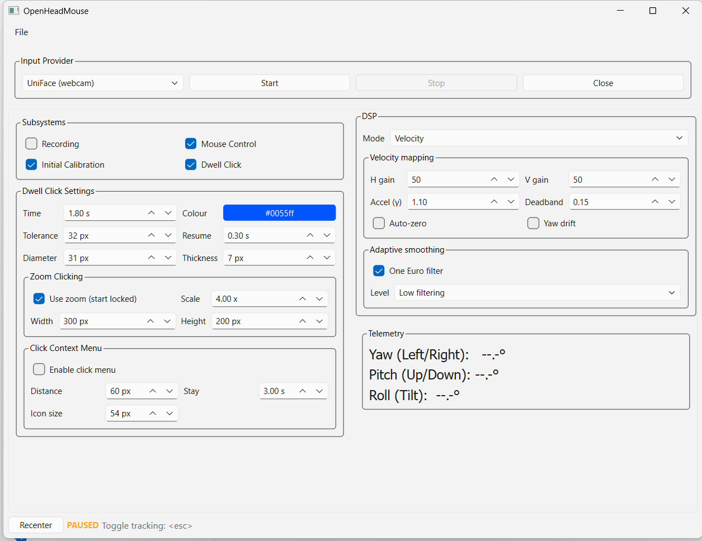

# OpenHeadMouse

Repository: [simonjudge/OpenHeadMouse](https://github.com/simonjudge/OpenHeadMouse).

The project was previously named HeadMouse. Existing recordings and settings remain
compatible; the saved Fitts start mode is migrated to **Start with OpenHeadMouse**.

OpenHeadMouse translates head movements into cursor control and provides tools for
recording, replaying and analysing pointing performance. Use a webcam, xIMU3, or
supported AirPods (macOS only), with optional dwell clicking.

**First release in preparation: `0.2.0-rc.1`.** This is experimental assistive and
research software, not a certified medical device or a validated clinical assessment.
Keep another way to control the computer available while testing. Stop if movement
causes discomfort.

- [Downloads and release notes](https://github.com/simonjudge/OpenHeadMouse/releases):
  choose **Full** unless you only need a standalone tool. A draft is not a public download.
- [Windows quick start](#windows-quick-start) | [Source setup](#setup-running-from-source)
- [Release checklist](RELEASE_CHECKLIST.md) | [Report a problem](CONTRIBUTING.md)
- [MIT licence](LICENSE) | [Third-party distribution review](THIRD_PARTY_NOTICES.md)



The screenshot shows the application alone with no live tracker or participant data.

### Platform support

| Platform | First-release status | Notes |
| --- | --- | --- |
| Windows x64 | Primary release target; clean-machine/hardware sign-off still required | Test Windows 10/11, permissions, DPI and multiple monitors |
| macOS 14+, Apple Silicon | Experimental | arm64 builds, not universal/Intel; camera, Accessibility and Input Monitoring permissions; AirPods also require Xcode command-line tools and Terminal Motion permission |
| Linux x64 | Experimental | Built on Ubuntu 24.04; X11 desktop expected; Wayland global hotkeys/input injection are not supported |

Only claim a tested OS/provider combination after recording its result in the
[release checklist](RELEASE_CHECKLIST.md). Successful packaging is not hardware validation.

## Windows quick start

1. When an approved release is available, download the **Full Windows x64 installer**
   and its `SHA256SUMS-Windows.txt` from the same release. Python is not needed.
2. Compare the download with its listed checksum:
   `Get-FileHash .\OpenHeadMouse-windows-amd64-setup.exe -Algorithm SHA256`.
   A checksum detects changed bytes; it does not replace publisher authentication.
3. Install and launch OpenHeadMouse. Current installers are **unsigned**. Windows may
   show an unknown-publisher/SmartScreen warning; do not disable protection globally.
   If you cannot verify or trust a download, do not run it.
4. Select your input provider. For a webcam, allow camera access and start tracking
   with **Mouse Control** and **Dwell Click** off. Confirm the telemetry follows your head.
5. Enable **Initial Calibration**, sit comfortably facing forward, then enable mouse
   control when ready. Start with gentle movements; tune gains to your needs.
6. **Esc pauses/resumes tracking.** Holding the cursor in a screen corner for the
   configured failsafe time pauses it too. Keep a physical mouse or helper available;
   verify both pause routes before enabling dwell clicking.
7. To record, enable **Recording** and choose a folder when prompted. Data is saved
   beneath its `sessions` and `fitts_sessions` folders. Reopen it from the File menu.

The portable EXE can be run without installing, but still uses per-user settings.
Do not expect portable settings alongside the EXE.

See [coordinate frames](COORDINATE_FRAMES.md) for mounting and movement conventions.

## Layout

- `core/` — quaternion math, absolute/velocity DSP engine and filters, recorder, OS cursor control
- `providers/` — input drivers (UniFace/MediaPipe, OpenSeeFace, xIMU3, AirPods)
- `gui/` — PySide6 setup and DSP tuning UI
- `session_viewer/` — standalone pyqtgraph session viewer (mesh + line-graph playback), opened from the main window's File menu; also replays Fitts sessions, optionally synchronised with a head recording (see below)
- `colab_session_viewer/` — [Colab notebook viewer](colab_session_viewer/README.md) with one head/cursor playback panel, multiple participants/sessions, pooled summaries and per-participant first-target exclusions
- `fitts_law/` — standalone ISO 9241-411 Fitts' Law test suite (circular + edge-target tasks, pluggable stimuli, Random Path and Typing Test modes), opened from the main window's File menu
- `dwell_click/` — standalone dwell-click engine, translucent progress overlay, and command-line launcher
- `tests/` — unit tests

### OpenSeeFace webcam provider

The self-contained adapter in [providers/openSeeFace.py](providers/openSeeFace.py)
receives pose data from an
[OpenSeeFace tracker](https://github.com/emilianavt/OpenSeeFace). The tracker,
not OpenHeadMouse, opens the webcam: until it sends packets the status reads
"waiting for ... facetracker". The adapter does not import, install or download
OpenSeeFace, and adds no Python dependencies to this project; it can optionally
launch a tracker you have installed.

1. Obtain OpenSeeFace from its upstream project (on Windows, the release zip
   contains `Binary\facetracker.exe` and its models). Either:
   - let OpenHeadMouse launch it by setting `tracker_command` in
     `config.json`, e.g. `"tracker_command": ["C:/OpenSeeFace/Binary/facetracker.exe"]`
     (or `["C:/path/to/python.exe", "C:/OpenSeeFace/facetracker.py"]`). It is
     started with `-c <camera> -i <udp_host> -p <udp_port>` plus `tracker_args`
     (default `--faces 1`), its output goes to the log, and it is stopped with
     the provider. If it exits, the status shows its exit code and last output; or
   - run it yourself: `.\facetracker.exe -c 0 --faces 1 -i 127.0.0.1 -p 11573`.

   Do not replace this project's dependencies with OpenSeeFace's older pinned
   Python dependencies; run `facetracker.py` in its own environment.
2. In OpenHeadMouse, select **OpenSeeFace (UDP webcam)** and click **Start**.
   Keep mouse control off while checking movement directions, then calibrate
   facing forward before enabling it. Do not run UniFace on the same camera.
3. For a console-only check from this repository's root, run
   `python -m providers.openSeeFace --port 11573 --face-id 0`
   (add `--tracker C:/OpenSeeFace/Binary/facetracker.exe` to launch it too).
   Turn left, look up and tilt the left ear down: yaw, pitch and roll respectively
   should increase. Physical webcam validation is still required.

The `providers.openseeface` settings in `config.json` accept `udp_host`, `udp_port`,
`face_id` (default `0`), `tracking_lost_hold_ms` (default `500`), `tracker_command`
(default `[]`, i.e. not launched), `camera` (default `0`) and `tracker_args`.
An externally run tracker
must send to that address/port and use the selected face ID. Localhost is the
default; this UDP protocol is unauthenticated, so do not expose it to untrusted
networks. No OpenSeeFace binaries or models are bundled with OpenHeadMouse.

Only successful 3D fits generate samples. On startup or after the configured
interval without a fresh valid pose, the provider reports `TRACKING_LOST`; it
resumes on the next valid sample without inventing capture timestamps or held
pose samples. Source timestamps come from OpenSeeFace's post-capture,
pre-inference wall clock. Duplicates and backwards timestamps are discarded;
restart the provider after resetting the sender clock. A socket/bind failure is
reported as an error, while malformed datagrams are logged and discarded.
Each provider gets an independent mouse profile, initially copied from the active
profile when no saved profile exists.

## Release editions

Release builds prepare four editions. Tagged builds create a **draft** release;
publishing it requires manual test and redistribution approval.

- **Full** — OpenHeadMouse, the Fitts' Law test suite, and the session viewer.
- **HeadMouse-only** — OpenHeadMouse without the Fitts' Law test suite or session viewer. Their
  File-menu items are omitted; head-movement recording and its folder setting remain available.
- **Dwell Click** — the standalone dwell-click tray application, without the OpenHeadMouse interface.
- **Session Viewer** — standalone head-movement and Fitts' Law playback, without starting
  head tracking or mouse control.

The Dwell Click edition starts its tray application when launched. Its settings and command-line
options are the same as the standalone `python -m dwell_click` mode described below.
Windows executables for all four editions are built without a console window. The Fitts'
Law suite and session viewer run within the full edition without opening a separate terminal.
This applies to newly built executables; existing downloads must be rebuilt or replaced.

Use the release build script below for consistent Windows packaging. Root-level
generated spec files are ignored and may contain stale local options; running
`pyinstaller main.py` directly can produce a console application.

### Building Windows executables and installers locally

Install [Inno Setup 6](https://jrsoftware.org/isdl.php) and install the Python dependencies
and PyInstaller into your build environment:

```powershell
.\.venv\Scripts\python.exe -m pip install -r requirements-windows-py312.lock
.\build-release.ps1 -Version 0.2.0-rc.1
```

Run these commands in PowerShell from the project root. If script execution is blocked,
use `powershell.exe -NoProfile -ExecutionPolicy Bypass -File .\build-release.ps1 -Version 0.2.0-rc.1`.
The script builds all four editions without console windows, then compiles their installers.
Executables and `*-setup.exe` installers are written to `dist`. Generated specs and Inno Setup
definitions go under `build/local-release`, leaving existing root-level specs untouched.
The script downloads missing pinned model assets, verifies their SHA-256 hashes,
exports dependency versions and discovered licence files, and smoke-tests each EXE
without starting tracking or clicking. It also writes checksums and a notices ZIP.

By default, the script uses `.venv\Scripts\python.exe` if present, otherwise `python` on PATH.
Use `-Python "C:\path\to\python.exe"` or `-Iscc "C:\path\to\ISCC.exe"` to override the tools.
It does not install Python dependencies. Installers are unsigned. Single-file binary
publication is deferred pending the [LGPL/model review](THIRD_PARTY_NOTICES.md).

## Setup (running from source)

Python 3.12 is the release/CI baseline. PySide6 is kept on the validated 6.11.x
series. Native crashes exposed a synchronised-window ownership cycle during
preparation; that lifecycle is now regression-tested. Newer Qt series need their
own validation before changing the Windows release lock.
Use a fresh virtual environment rather than modifying a working installation.

Windows PowerShell:

```powershell
py -3.12 -m venv .venv
.\.venv\Scripts\python.exe -m pip install -r requirements.txt
.\.venv\Scripts\python.exe tools\prepare_release.py --assets
.\.venv\Scripts\python.exe main.py
```

macOS/Linux:

```bash
python3.12 -m venv .venv
source .venv/bin/activate
python -m pip install -r requirements.txt
python tools/prepare_release.py --assets
python main.py
```

Network access is needed for dependency/model setup, not routine desktop tracking
once the assets are installed. For development, install `requirements-dev.txt`.

### Privacy and diagnostics

Desktop camera processing is local. Recordings contain timestamps, head orientation,
cursor trajectories and any study notes/labels you enter; treat them as potentially
sensitive. Do not commit participant recordings, ZIPs or notebook outputs.
Colab uploads go to Google's runtime: see the [notebook privacy notes](colab_session_viewer/README.md).

Frozen Windows applications write diagnostics to
`%LOCALAPPDATA%\OpenHeadMouse\logs`; macOS uses `~/Library/Logs/OpenHeadMouse`
and Linux uses `$XDG_STATE_HOME/OpenHeadMouse/logs` (or `~/.local/state/...`).
The latest log and one previous run are retained per edition. Logs can include paths
and exception details: inspect/redact them before attaching them to an issue.
Source launches keep their usual terminal output.

## MODULE NOTES:
### Standalone session viewer

From the repository root, with the dependencies installed, run:

```powershell
python -m session_viewer
```

The viewer opens without a recording loaded. Use its File menu to open a head-movement
session (JSON or CSV), a Fitts test, or synchronised head/Fitts playback. It does not start
OpenHeadMouse, connect to a tracker, or control the cursor. The main application's File-menu
viewer continues to work as before.

Opening **Open Synchronised Playback...** automatically tiles the head viewer on the left
and Fitts playback on the right. Both windows have **File > Tile Windows Side by Side** to
restore this layout after moving or maximising them. The command uses the available area
of the screen containing the window where it was selected, moving both windows onto that
screen. It is disabled when the other playback window is closed.

For a development-only standalone viewer executable:

```powershell
python -c "from session_viewer.mesh_visualizer import download_mediapipe_model; download_mediapipe_model()"
python -m PyInstaller --noconfirm SessionViewer.spec
```

The versioned viewer spec is the exception to ignored, locally generated root specs.
For release deliverables, use the Windows build script so notices and smoke tests are included.
On Windows the spec creates `dist\SessionViewer.exe` without a terminal window. The face mesh
is bundled, so no model download is needed at runtime. Tagged releases also package the
viewer as a Windows installer, Linux executable/`.deb`, and macOS executable/`.app`/DMG.

### Colab session viewer

Open [session_viewer.ipynb](colab_session_viewer/session_viewer.ipynb) in Google Colab
and run its setup and viewer cells. Import individual head/Fitts recordings or
multiple ZIP data sets, with or without a participant/session manifest. ZIPs without
a manifest offer timestamp-based head/Fitts pairing, editable labels and a
downloadable manifest for reuse. The single viewer
follows the import block and switches between participants and sessions. Six
tables below it summarize sessions, head-only initial positions (with participant
wireframes), task-only range of movement, whole-session head movement, Fitts
targets/hits and Fitts performance, with one-decimal display and CSV export. Each participant can
exclude the first N targets **per Fitts file** from the summary without changing
playback or removing whole tests. See the [notebook guide](colab_session_viewer/README.md)
for setup, batch import format, aggregation definitions and data-privacy notes.

### Dwell click

Tick **Dwell Click** in the Subsystems panel to click automatically when the pointer remains
inside the configured movement tolerance (default 10 pixels) for the dwell time (default 1
second). A translucent red ring around the cursor fills clockwise as the dwell completes. After
a click, the pointer must leave the activation area before another click can occur.
The main window shows **Dwell Click Settings** only while **Dwell Click** is ticked.
Unticking it hides the settings without discarding their values; tray settings remain available.

Ticking the box only arms the feature. Dwell clicking starts only once the input provider is
actually controlling the cursor (mouse control active and head data moving the pointer), not
merely when **Start** is pressed or tracking is resumed. It stops whenever mouse control is
switched off, paused by the toggle hotkey or corner failsafe, or suspended during initial
calibration.

If the pointer leaves an activation area and returns within the configurable resume time
(default 0.5 seconds), progress continues from where it paused. Dwell time, movement tolerance,
and resume time can be changed in the main window and are persisted in `config.json`.

The timer ring's appearance is also configurable: **Diameter** (size of the circle, default 40
pixels), **Thickness** (width of the timer segment, default 4 pixels), and **Colour** (click
the swatch to open a colour picker). These are saved as `ring_diameter_px`,
`ring_thickness_px`, and `ring_color` under `ui.dwell_click` in `config.json`, and the same
options appear in the tray's dwell-click settings dialog.

The module can also run independently of OpenHeadMouse:

```
python -m dwell_click
python -m dwell_click --dwell-time 1.5 --movement-tolerance 12 --resume-time 0.75
python -m dwell_click --diameter 60 --thickness 8 --color "#00a0ff"
python -m dwell_click --zoom --zoom-width 300 --zoom-height 200 --zoom-scale 4
```

Both standalone mode and OpenHeadMouse provide a cross-platform system-tray icon. Its menu starts
or stops dwell clicking, opens the dwell-click settings dialog, and exits standalone mode.
Left-clicking the tray icon opens the settings dialog directly; right-clicking opens its menu.
The settings dialog also has a **Start/Stop Dwell Clicking** button. It stays open when
the button is used and follows changes made through the tray or OpenHeadMouse lifecycle.

**Click Context Menu** is optional and disabled by default. Enable it in the main window's
dwell settings or the tray settings dialog. A completed dwell opens five icons around
the original click point: **left click** at 135 degrees (upper-left), **zoom** at 90 degrees
(above), **right click** at 45 degrees (upper-right), **double click** at 225 degrees
(lower-left), and **pause** at 315 degrees (lower-right). Dwell on an icon to choose it.
Each icon samples the screen beneath it when the menu opens: dark backgrounds use white
artwork and a 20%-opacity white backing; light backgrounds use dark artwork and a
20%-opacity black backing. Rounded corners remain transparent and active choices have a
contrasting blue outline. If screen sampling is unavailable, a warning is logged and the
application colour scheme is used. **Icon size** sets each square target's size
(default 54 pixels, 50% larger than the original 36; range 24-200), with artwork scaled
proportionally. **Distance** sets P, the distance to each icon centre (default 60 pixels;
minimum 48). Spacing grows when needed to prevent larger targets overlapping.
The group shifts together near screen edges to keep the icons visible; spacing is reduced
if the configured distance would make the group wider or taller than the display.
When the dwell target is on the taskbar (outside the screen's usable area), the menu is
placed at least 260 pixels away from the taskbar, clear of the window previews that pop up
there; the zoom box is moved clear in the same way (it still magnifies the taskbar area). Windows draws those previews above all normal programs, even always-on-top ones;
see the UIAccess next step below.

Left, right and double click are the click buttons ("L/R" below includes double click).
The first L/R choice is remembered across menu openings. Each new menu has its own original
target: selecting an icon clicks that target, not the icon or a target from a previous menu.
The menu closes before clicking and the cursor stays at the clicked location; it is not
warped back to the icons. Menu and zoom clicks rest on the target for about 120 ms before
pressing, so custom-drawn title-bar buttons (e.g. browser or Windows 11 app close buttons)
register the hover and accept the click.

| Menu choice | Effect | Menu |
| --- | --- | --- |
| First L or R selection | Click the original target once using that button; remember the choice | Closes |
| Same L/R at a later target | Lock that button and click this target once | Closes |
| Already-locked L/R icon | Unlock that button, clear its remembered choice; no click | Closes |
| Different L/R while a button is locked | Unlock the old button and click once with the new choice; choosing it again later locks it | Closes |
| First zoom selection, with L/R already chosen | Magnify this pending click and click with the locked or remembered L/R | Closes |
| First zoom selection, no L/R chosen yet | Highlight zoom and wait; choosing L or R then magnifies and clicks with that button | Stays open |
| Second zoom selection (a later menu) | Lock zoom independently of L/R; magnify and click as above | Closes, or stays open if no L/R is chosen |
| Already-locked zoom icon | Unlock zoom only; no click | Closes |
| Zoom selected after an automatic click was already sent | Arm zoom for the next target, or lock it on the second selection; never repeat the completed click | Closes |
| Pause | Cancel the pending click and pause dwell clicking; locks are kept | Closes |
| Dwell outside an unlocked menu | Cancel without clicking | Closes |

**Pause** stops all dwell clicking and shows a floating **Resume** (play) button in the
bottom-right corner of the screen. Dwell on it to resume hands-free, or use **Start Dwell
Clicking** in the tray menu or settings dialog. While paused the tray shows Start; the main
window's Dwell Click checkbox stays ticked. If Resume appears under the pointer, move off it
and back before dwelling. Stopping dwell clicking also clears the pause.

Locked options have blue outlines. Future target dwells use the selected button directly
when L/R is locked, opening the magnifier first when zoom is also locked. If only zoom is
locked, the menu still opens so L or R can be chosen for the zoomed click.
After these automatic clicks, the menu appears for **Stay** seconds (S, default 3), allowing
unlocking or a different choice. Switching to the other L/R intentionally sends one click
with the newly selected button at that menu's target, even if the previous automatic click
was already sent. Dwelling outside this timed menu performs the next automatic click.
The dismissal timer pauses during an icon dwell so an action can finish near the deadline.
If the menu opens underneath the pointer, leave the icon and re-enter it before selecting;
remaining stationary cannot immediately unlock a newly locked option.

**Use zoom (start locked)** seeds the independent zoom lock when starting dwell clicking.
Menu selections change runtime locks only: they do not toggle the checkbox or save locks.
For example, unlocking zoom in the menu leaves the checkbox checked; restarting restores
the configured zoom default. Stopping or changing settings clears remembered selections and
L/R locks, and reapplies that zoom default.

OpenHeadMouse persists `context_menu_enabled`, `context_menu_distance_px`, `context_menu_size_px`,
and `context_menu_lock_time_s` under `ui.dwell_click`. Standalone mode also accepts
`--context-menu --menu-distance 60 --menu-size 54 --menu-lock-time 3`.
After zoom opens, move away from the icon-selection position before dwelling on the image;
remaining still will not complete or cancel the precise click.

**Zoom clicking** is optional and disabled by default. Enable it in the main window or tray
settings to start with zoom locked, or select zoom once from the context menu. The magnifying
dwell opens a borderless screenshot around that point without
clicking the application. Move the pointer beyond the movement tolerance, then dwell on the
desired pixel inside the box to complete the selected L/R click at the original screen location
(left click when running without the context menu).
Dwelling outside the box cancels without clicking. Simply remaining still after the box opens
does not complete a click. The same dwell time and tolerance apply to both stages.

**Width** and **Height** set the displayed box size (default 300 by 200 pixels);
**Scale** sets magnification (default 4x, without image smoothing). The box and captured area
are kept on the pointer's display and the box is reduced to fit smaller screens. These sizes
use Qt screen coordinates (logical pixels on scaled displays); selection maps back to
individual captured screen pixels, including on high-DPI displays. OpenHeadMouse saves
`zoom_enabled`, `zoom_width_px`, `zoom_height_px`, and `zoom_scale` under `ui.dwell_click`
in `config.json`. Standalone settings apply for the current run, with command-line options
available as above. Stopping dwell clicking or changing settings cancels any pending zoom click.
Screen capture must be permitted by the OS; capture failures are logged and shown through
a tray notification rather than falling back to an unzoomed click. Pointer-control permission
is also required; if the cursor cannot reach the selected point, the click is cancelled and
an error is reported.

**Possible next step: UIAccess (Windows).** Taskbar previews, the Start menu and windows of
programs running as administrator sit in Windows z-order layers above every normal program,
so the dwell menu can be hidden by them and clicks into elevated windows are blocked.
Accessibility software such as OptiKey avoids this with *UIAccess*, which lets an app
draw above those layers and interact with elevated windows without itself running as
administrator. Requirements:

* Manifest flag `uiAccess="true"` (PyInstaller: `uac_uiaccess=True` in `EXE(...)` in the
  `.spec` file). Make it opt-in for release builds only: an unsigned UIAccess exe will not
  start ("A referral was returned from the server").
* Authenticode-sign the exe with a certificate trusted by the installing PC. Options:
  * Trusted, no extra steps for users: an open-source code-signing certificate (e.g.
    Certum Open Source, as OptiKey uses), SignPath Foundation (free for open-source
    projects) or Azure Trusted Signing.
  * Self-signed (for testing on your own PCs): each PC must import the certificate into
    *Local Machine > Trusted Root Certification Authorities* (admin rights). That PC
    then trusts anything signed with the key, so keep the private key safe and out of
    the repository.
* Install the exe in a secure location such as `C:\Program Files\...`; by default Windows
  refuses to start a UIAccess exe from user folders such as Downloads.

Running Dwell Click as administrator is a simpler interim workaround for clicking into
elevated windows, but it does not lift the menu above taskbar previews or the Start menu.

## GENERAL NOTES:
### Coordinate frame and gain signs

All providers emit quaternions in one canonical head frame (+X forward, +Y left, +Z up), so
for every provider turning left gives **positive yaw**, looking up gives **positive pitch** and
tilting the left ear down gives **positive roll**. Cursor mapping uses the same signs in
absolute and velocity mode: **positive gains make the cursor follow the head** (turn left →
cursor left, look up → cursor up). A negative gain inverts that axis. If a provider needs
negative gains to feel natural, its frame conversion is wrong. See
[COORDINATE_FRAMES.md](COORDINATE_FRAMES.md) for the per-provider conversions and a checklist
for adding a new provider.

Main-window labels are kept short and related options sit side by side; hover over any
option to see a fuller explanation. The main window uses two columns for dwell and DSP
settings, with scrollbars on smaller screens so enabling every option does not push the
bottom controls off-screen. Provider controls and Recenter remain outside the scrolling area.

The DSP configuration supports absolute mapping and velocity mapping. The optional One Euro
filter applies adaptive smoothing in either mode. The main window shows **DSP** settings only
while **Mouse Control** is ticked; hiding the settings preserves their values. Velocity mode
also supports deadband/gamma
shaping, stationary auto-zero bias, and optional yaw-drift correction. Cursor clamping
follows the display that contains the OpenHeadMouse window, including displays with negative
coordinate origins. On Windows, native pixel bounds are used so display scaling does not
shrink the usable cursor area. The bounds are refreshed and the cursor is centered on that
display whenever tracking starts.

On Windows, head-driven movement uses absolute mouse-input events across the virtual
desktop rather than only repositioning the cursor. This allows Windows to restore a pointer
suppressed after touch/pen input, independently of whether **Dwell Click** is enabled.
Blocked input pauses tracking and displays a permissions warning.

The real Windows pointer is separate from the dwell ring, zoom box and click-menu overlays.
Those overlays can be covered by taskbar previews or privileged windows (see UIAccess above);
UIAccess is not a general fix for an invisible native pointer. If pointer movement or clicking
is blocked over an application running as administrator, OpenHeadMouse needs matching permissions
or an appropriately signed/installed UIAccess build. Secure-desktop prompts remain out of scope.

### Recordings folder

Everything this app records is written under one base folder, so a study's data stays
together:

```
<recordings folder>/sessions/        head-movement session files
<recordings folder>/fitts_sessions/  Fitts' Law result files
```

Set it from the main OpenHeadMouse window with **File → Set Recordings Folder...**; the folder in
use is shown on the **Saving to:** line just below it in the File menu. The chooser opens at the
current folder, and the new folder applies straight away, including to a session that is
already being recorded. The choice is saved in `config.json` as `recorder.base_dir` and is shared
with the Fitts' Law test window.

Before anything is recorded, the folder and its `sessions/` and `fitts_sessions/` subfolders are
created if missing and checked to be writable. This happens when **Recording** is switched on,
when a provider is started with **Recording** on, and before every Fitts test (its results are
always saved). If no folder has been chosen, or the chosen one can't be used (for example a
removed drive or no write permission), you are asked for another one. Cancelling refuses to
record rather than writing to a default folder: Recording is switched back off, tracking with
Recording on is not started, or the Fitts test is not started, with a message saying why. If a
head session still can't be saved when tracking stops, you are asked for another folder; it
is only discarded if you confirm that.

The Fitts window run standalone (`python fitts_law/fitts_test.py`) does the same checks itself
and saves the chosen folder to `config.json` and to its own `fitts_law/fitts_settings.json`, so
it is only asked once either way.

### Session files

Each Start → Stop run of a provider is saved as its own session file when **Recording** is on.
The recorder is cleared after every save. Earlier versions kept every sample since launch, so
each file also held data from previous runs, sometimes from different providers with different
clocks. The session viewer handles those older files by switching to `host_time` when the
provider timestamps aren't one consistent clock. For old files without `host_time`, the plots
can still look squashed.

### Angular speed and acceleration

Head speed is the geodesic angle between consecutive orientation quaternions divided by the
elapsed time, rather than the length of the yaw/pitch/roll difference vector. The geodesic
angle is the true rotation magnitude, so it doesn't inflate near gimbal lock and doesn't jump
at the ±180° yaw wrap.

Samples are delivered in bursts, so a few consecutive pairs arrive microseconds apart while
carrying a normal amount of rotation. Dividing by those tiny intervals produced peaks of
hundreds or thousands of deg/s that were artefacts of delivery timing, not head movement.
Intervals shorter than half the session's median interval are therefore skipped instead of
being differentiated. `SessionStats.sampling_stats()` reports the effective sample rate and how
many intervals were skipped, and the viewer shows both in the Session Data panel. The viewer's
Vel/Accel graphs use the same computation as the statistics panel, so the two always agree.

### Initial calibration

Tick **Initial Calibration** (Subsystems panel) to capture the at-rest head pose each time a
provider is started. A fullscreen target appears on the tracking display asking the user to
hold a neutral head position. After a read period (`calibration.read_duration_s`, default 5 s)
a countdown (`calibration.capture_duration_s`, default 5 s) runs while samples are captured.
The cursor does not move and no movement samples are recorded during this time. The mean
quaternion becomes the neutral reference (the same recentre used by the **Recenter** button),
the cursor is centred and tracking starts. Press Esc (or Stop) to abort; the provider stops.

When **Recording** is on, the capture is saved separately from movement data: JSON sessions
(`format_version` `1.1`) gain a top-level `calibration` object (timestamps, sample count,
neutral quaternion, neutral yaw/pitch/roll, their standard deviations, and the raw
calibration `samples`); CSV sessions gain a `phase` column (`calibration`/`movement`). Files
without calibration keep the previous format. The session viewer shows this under
**Calibration** in the Session Data panel: the mean at-rest Yaw/Pitch/Roll, each ± its
standard deviation during the capture.

Main-window settings are saved to `config.json` as they change and restored at the next
launch. Mapping mode and gains, velocity parameters, adaptive smoothing, auto-zero, and yaw
drift correction are stored separately for each input under `mouse_profiles`; selecting a
provider immediately restores its complete movement profile. Legacy configurations with one
top-level `dsp` section are migrated by copying that profile to every configured provider.
The selected provider, recording, mouse-control and calibration toggles, and xIMU3
magnetometer mode and mounting orientation remain global. When the application is launched
with `--config`, settings are saved back to that selected file.

Packaged builds initialize their per-user `config.json` from the bundled defaults on first
launch, then save settings to the user's configuration directory.

### xIMU3 mounting orientation

When xIMU3 is selected, the **Mounting** dropdown appears beside the magnetometer
option. Choose **LHS-Horizontal**, **LHS-Vertical**, **RHS-Horizontal**, or
**RHS-Vertical**. Horizontal means hanging from glasses with USB pointing backward;
vertical means mounted on the temple with USB pointing down. Printed arrows face
out of the head in all four cases.

The selection saves `axes_alignment` and `ahrs_axes_convention` and sends both
settings to a connected device (USB or Wi-Fi). During a Wi-Fi outage it is applied
on reconnection. Changing a live mount resets cursor mapping and restarts calibration
if enabled. Existing non-preset settings appear as **Custom (from config)** and
are preserved until a preset is selected. See [Coordinate Frame Conventions](COORDINATE_FRAMES.md)
for the preset alignments.

### xIMU3 Wi-Fi AP connection

Join the device's Wi-Fi AP before starting xIMU3. The device picker scans for USB and Wi-Fi
announcements in the background; **Refresh devices** retries the scan. If announcements are
missed, **Connect directly** uses `providers.ximu3.wifi_ip_address`,
`wifi_port_send`, and `wifi_port_receive` from `config.json` (defaults:
`192.168.1.1`, `9000`, `8001`). Announced devices instead use their advertised
UDP ports. Confirm the computer is actually joined to the device's AP when direct
connection does not produce data.

The status under Input Provider distinguishes connection, configuration, waiting for
samples, streaming, and reconnection. Tracking and initial calibration wait for a
configured connection and a real quaternion. During a Wi-Fi outage cursor updates stop;
the SDK retries until Stop is pressed. On recovery tracking resumes using the previous
neutral pose, without counting the outage as a new recording session. Calibration that
was interrupted before completion restarts after samples resume. Configuration-command
rejections are errors, not successful connections. Both USB and Wi-Fi startup
verify and apply the saved device settings.

The xIMU3 SDK timestamps quaternion messages in microseconds of device time. The provider
converts these to seconds before velocity-mode processing and recording, matching the
other providers' timestamp unit; the measured sample interval, not the configured target
rate, determines angular speed. Existing recordings made before this conversion retain
their original microsecond timestamps and are not migrated.

Requires the `ximu3` Python package 1.9.1 or newer. Settings are sent as JSON commands
(e.g. `{"axesAlignment": 2}`) followed by `{"apply": null}`, as the x-IMU3 protocol requires.

### Absolute-mode fine pointing

Enable **One Euro filter** under **Adaptive smoothing** to reduce cursor jitter when
selecting small targets, then choose a filtering level:

- **Low filtering** — most responsive; use when the input is already stable.
- **Medium filtering** — balances stability and responsiveness and is the recommended default.
- **High filtering** — steadier fine pointing, with more noticeable movement lag.

For tuning, run the same small-target Fitts condition with smoothing off and on. Compare
error rate and throughput, starting with Medium and moving to High only if needed. The
checkbox is optional—when disabled, absolute mapping uses the unfiltered yaw and pitch values.

Saved filter values that do not match a preset appear as **Custom (from config)**.
They remain active until you explicitly select a preset.

Absolute mode applies the calculated screen position directly, including after recentering
and returning from a display edge. Velocity-mode settings changes preserve the current
cursor position; pausing or disabling mouse control prevents background movement from
accumulating into a jump on resume.

In Velocity mode, **Auto-zero** (bias) estimates angular-rate bias after sustained low-speed
motion; **Yaw drift** (correction) estimates the remaining yaw-rate bias more slowly using
its configured time constant. Both subtract rate estimates rather than accumulating pose
offsets. With both disabled, only the configured deadband suppresses small movements.
These estimates cannot distinguish sensor drift from deliberately very slow movement:
disable them for unrestricted fine motion. They do not recenter Absolute mode.

### Recording head movement during a Fitts test

The Fitts window's setup page has a **Record Head Movement** option and a **Start Test**
button with a start-mode dropdown to its right:

- **Record Head Movement** records head movement alongside the Fitts data, using the tracker,
  **Initial Calibration** and **Recording** settings of the main OpenHeadMouse window. It turns
  **Recording** on so the head session is saved. The head session and the Fitts session can then
  be replayed together with **Open Synchronised Playback…**.
- **Start Test** runs the test with whatever is already driving the OS cursor (head mouse,
  trackpad, eye gaze, switch, etc). The test window itself stays agnostic to the input device.
  With **Record Head Movement** ticked, it also brings the head tracker up but switches
  **Mouse Control** *off*, so head movement is recorded while the access method being measured
  keeps the cursor. This is how head movement is captured during, say, an eye-gaze or switch run.
- **Start with dwell click** adds dwell clicking to the current cursor input for the mouse
  task. When hosted by OpenHeadMouse it reuses the main GUI's dwell timing, tolerance and ring
  settings without changing its enabled checkbox. Standalone runs use the default dwell settings.
  Dwell clicking (including dwell enabled in the main OpenHeadMouse GUI) is suppressed during
  tracker startup and all head exercises; it starts only when the mouse task begins.
  Dwell clicking and OpenHeadMouse stop when the mouse task completes, is cancelled, or the
  window closes. The head recording is saved automatically and retained for playback.
- **Start with OpenHeadMouse** records head movement *and* drives the cursor with
  it. It starts the chosen provider exactly as the setup panel's **Start** button would, ticking
  **Record Head Movement** and switching **Mouse Control** on. If initial calibration is enabled,
  the calibration overlay runs first and the trials only begin once the neutral pose has been
  captured and tracking is live. If the tracker is already running, the test starts straight away.
  It respects the main GUI's dwell-click enabled setting, sets **Access method** to OpenHeadMouse,
  and is disabled when the Fitts window is run
  standalone (`python fitts_law/fitts_test.py`), where there is no OpenHeadMouse app to drive.

Either way the head recording covers the whole run, so its samples can be labelled by phase (see
below). `metadata.record_head_movement` in the Fitts file records which mode was used.

The **Tasks** dropdown selects **HeadMovement and Mouse Task**, **HeadMovement only**, or
**Mouse Task only**. HeadMovement always includes both tasks below and requests head recording
when hosted by the main app. In standalone runs it records the task timings and cursor
trajectories, but cannot start a head tracker. Head-only runs skip the mouse trials and do not
require valid mouse-task settings.

- **Initial Rest Position (Calibration)** gives the participant the configured move/read time
  to adopt a comfortable neutral pose, then records it for the configured hold time. It uses the
  same neutral-pose calculation as the main OpenHeadMouse calibration. If OpenHeadMouse is running, its
  cursor is paused during the task and the held pose recentres it before the next task.
- **Range Of Movement Task** asks for maximum comfortable movement in this order: left, right,
  up, down. For each direction a red band marks the corresponding screen edge. The participant
  gets the configured move time to reach it and the configured hold time to maintain it.

**Time to move/read instructions** and **Time to hold/record position** are shared by both tasks.
Press Esc to cancel a pre-test sequence and return to setup.

At completion the test window closes before its results are saved. If saving fails, a warning
explains the error and a folder chooser lets you retry (the JSON is saved directly in the selected
folder). Cancelling the chooser reopens the results window with the data still in memory, so
**File > Save Results As…** can be used later. Both mouse trials and head-only task records are
saved. When hosted by OpenHeadMouse, reopen the Fitts window from the File menu to inspect the results.
Use **File > Close** or `Ctrl+W` to stop a run midway. Head tracking
and dwell clicking stop, partial mouse trials/head-task phases are saved, and unfinished phases
are marked as cancelled. The setup window and both playback windows have the same Close controls;
the setup panel and fullscreen calibration overlay also have a Close button.

All provider samples are retained during calibration, range-of-movement and Fitts trials (the
cursor still uses only the newest sample per GUI update). In head-session JSON/CSV each sample's
`metadata.task_phase` identifies its section, for example
`initial_rest.hold`, `range_of_movement.left.move`, or `fitts_test`. Head-session `task_phase`
events mark the same boundaries. The Fitts JSON `metadata` contains:

- `pretest_configuration` — enabled tasks and configured move/hold durations;
- `pretest_phases` — ordered phase labels, task/direction/segment, shared-host-clock start/end
  times, and cursor trajectories captured during each phase;
- `fitts_task` — the `fitts_test` phase label, shared-host-clock boundaries, and completion flag.

These labels allow the neutral-rest, range-of-movement and pointing data to be extracted without
inferring boundaries from timing. The held neutral samples also remain in the head session's
top-level `calibration` section for existing calibration analysis.

### Fitts playback and synchronised playback

The session viewer's File menu has three ways to open a recording:

- **Open OpenHeadMouse Session…** (`Ctrl+O`) opens a head-movement recording on its own.
- **Open Synchronised Playback…** (`Ctrl+Shift+O`) asks for a head-movement session and then a
  Fitts session. The two windows are then driven by one shared playback clock, so Play, the slider
  or the speed control in either window moves both. Playback covers the head-movement exercise
  (initial head position and range of movement) and the mouse task. Head data recorded before
  or after these is not shown, and head statistics cover only that period. Times in both
  windows are measured from the start of the exercise (or of the mouse task when there was no
  exercise).
- **Open Fitts Test Only…** (`Ctrl+F`) opens a Fitts playback window on its own. The left side shows a scaled drawing of the test screen. It shows the current target
  (diameter W), the start point, the dashed task axis, the cursor trail up to the playhead, the
  cursor, and click markers (green for a hit, red for a miss). Earlier trials of the same condition
  are drawn faded. Below the drawing are graphs of cursor speed and distance to target, with a
  playhead and vertical lines at each trial's start (green, dashed) and click (purple, dotted).

All three are also on the viewer's toolbar.

**HeadMovement only** Fitts files also open through these options, even with no mouse trials.
Playback follows the recorded initial-rest/range-of-movement phases and their cursor traces;
pointing measures are marked as not applicable and mouse-task graphs are hidden. For runs with
both tasks, playback first shows the exercise phases and then the mouse trials.

The head viewer always chooses a neutral reference for the face mesh: the recorded recenter/
calibration pose (including a Fitts initial-rest calibration), otherwise phase-labelled
`initial_rest.hold` samples, otherwise the mean of up to the first 30 samples within the first
second of use. The fallback uses the beginning of the original recording, even when playback
is trimmed to a later task. Disabling **Initial Calibration** therefore no longer makes the
viewer average the whole movement exercise to guess a neutral pose. The Calibration panel
identifies an inferred reference when no explicit calibration was recorded.

The right side of the Fitts window uses the same layout as the head viewer. The **summary** shows:

- ISO 9241-411 results: error rate, mean MT, Ae, We, IDe and throughput.
- The path-accuracy measures from MacKenzie, Kauppinen & Silfverberg, *Accuracy measures for
  evaluating computer pointing devices* (CHI 2001):
  - target re-entry (TRE), task axis crossing (TAC), movement direction change (MDC) and
    orthogonal direction change (ODC), as mean counts per trial;
  - movement variability (MV), movement error (ME) and movement offset (MO), in px.

  They are computed from each saved trajectory in task-axis coordinates, with the click point
  as the last path point.

The summary can exclude the first N repetitions of each condition. **Live Data** shows the current
task in words, for example "Range of movement - holding head at furthest LEFT position" or
"Fitts mouse task". During the mouse task it also shows the current trial and its measures, up to
the playhead. The head viewer's **Live Data** shows the same task description, from each head
sample's `task_phase` label.
Hover over any measure name in **Summary**, **Live Data**, or **Initial Pose & Range of Movement**
for its definition, units, and (where relevant) formula or interpretation. This includes Ae,
We, IDe, throughput, TRE, TAC, MDC, ODC, MV, ME and MO. Path-accuracy summaries average the
measure over trials with usable recorded paths; live measures use only the path up to the playhead.

#### Initial pose and range of movement summary

When the run included the pre-test tasks, an **Initial Pose & Range of Movement** box appears below
the summary (it is hidden for sessions without that data). It is built from
`metadata["pretest_phases"]` in the Fitts file, so it is available in **Open Fitts Test Only…** too:

- **Initial head pose** — cursor drift during `initial_rest.hold` (σx, σy and the largest deviation
  from the mean position), the hold duration and the number of cursor points.
- **Range of movement** — the extreme cursor position reached in each `range_of_movement.*.hold`
  phase, plus the overall horizontal and vertical cursor ranges in px.

The cursor position is sampled on every exercise tick (about 20 Hz). Mouse-move events alone
were not reliably delivered while OpenHeadMouse moved the hidden cursor, so earlier recordings may
hold few or no cursor points.

The head session's samples are also passed to the Fitts window. In **Open Synchronised
Playback…** you choose that session. **Open Fitts Test Only…** finds it automatically: first the
file named in the Fitts file's `metadata["head_session_file"]`, which is written when the test
saves its head recording, then the `session_*.json` saved closest in time in the neighbouring
`sessions` folder. A head file is used only if its timestamps overlap the Fitts session. Their `metadata.task_phase` labels add head-pose statistics: mean and standard deviation of
yaw, pitch and roll at rest, the mean angle held in each direction with its offset from the rest
pose, and the resulting yaw (left↔right) and pitch (up↔down) ranges in degrees.

The same pair of windows can be opened straight from the Fitts test. Reopen the test window
after a mouse-task run finishes; its results page has an **Open Synchronised Playback…**
button (also in that window's File menu,
alongside Save/Open Results). It uses the head recording saved at completion (or stops and saves
one if still running), then
opens the two playback windows side by side, each filling half the screen. If the Fitts test was
run on its own, it asks which head session to use.

Synchronisation relies on a shared host clock (`core/clock.py`, the host's wall-clock time in
Unix-epoch seconds). It doesn't use `time.monotonic()`, because that clock stops while macOS
sleeps. Provider timestamps use each device's own clock, so they can't be compared
between files. Head sessions now save a `host_time` for every sample and event: a
`host_time` field plus a top-level `"clock"` key in JSON, or a `host_time` column in CSV.
Fitts sessions (`format_version` `1.1`) save `start_host_time`/`end_host_time` for every trial,
plus the screen size in `metadata`. Synchronisation is refused, with an explanation, if either
file has no host timestamps (recordings made before this change) or the two recordings don't
overlap in time. You can still play the Fitts session on its own.

## Validation

Install development dependencies and run checks from the repository root:

```powershell
.\.venv\Scripts\python.exe -m pip install -r requirements-dev.txt
.\.venv\Scripts\python.exe -m pytest -q
node --test .\colab_session_viewer\viewer.test.cjs
.\.venv\Scripts\python.exe tools\check_publication.py
```

Tests configure offscreen Qt by default and have a per-test timeout. On Linux, use
`QT_QPA_PLATFORM=xcb xvfb-run -a python -m pytest -q` so OpenGL widgets have a
supported X display/context. CI runs these checks
before packaging. The publication check is pattern-based and not an exhaustive audit.

Camera, xIMU3, AirPods, global hotkey, and native Swift helper behavior require the
corresponding hardware and macOS permissions; the protocol and provider unit tests run
without those devices.

Press **Esc** to pause or resume cursor tracking.

On macOS, the global toggle uses `Cmd+Option+M` (`<cmd>+<alt>+m`). Grant Accessibility
and Input Monitoring permission to the executable that actually runs the app (usually
the project virtual-environment Python, not just VS Code), then restart OpenHeadMouse.
If registration is denied, the main window displays the reason instead of silently
claiming the hotkey is active.

## Contributing and support

Use the [bug-report guidance](CONTRIBUTING.md), include your edition, version,
OS and provider, and share only anonymised/reproducible examples.
For potentially sensitive vulnerabilities, follow the [private reporting guidance](SECURITY.md).
